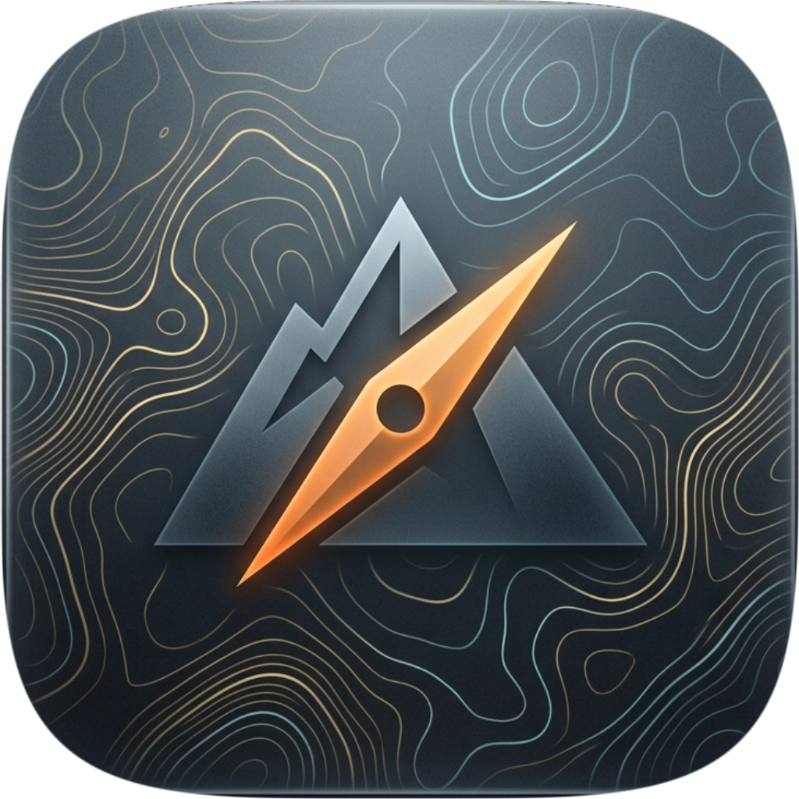

<p align="center">
  
</p>

<h1 align="center">ZiMap Downloader <br/><sub>[BETA]</sub></h1>

<p align="center">
  <strong>Desktop application for downloading OpenStreetMap regional extracts and compiling them into native <code>.img</code> format for GPS navigators and outdoor smartwatches.</strong>
</p>

<p align="center">
  
  
  
  
</p>

---

> **Built with AI / AI-Assisted Engineering**:  
> This project was architected and developed with the active assistance of Artificial Intelligence (LLM coding agents). The application is currently in **BETA** (active development and testing).

---

## Key Features

- **Multi-Provider Map Catalogs**: Instant region search and downloads from Geofabrik, OpenStreetMap France, and pre-compiled BBBike styles (240+ metropolitan cities worldwide).
- **Automated Compilation Pipeline**: Intelligent tile splitting (`splitter`) and compilation (`mkgmap`) into a unified `.img` file complete with routing graphs and contour lines.
- **Device & Smartwatch Sync**:
  - Automatic detection of connected USB mass storage GPS devices.
  - Native macOS MTP driver sidecar (`zimap-mtp`) for seamless direct file transfer to smartwatches without external tools.
  - Real-time map freshness check comparing PC builds with device storage, plus one-click sync.
- **Apple HIG Native Interface**: Frosted glass Vibrancy UI (Dark/Light themes), background download queue, live transfer speed, and ETA indicators.
- **Headless CLI Mode**: Run `zimap` directly from terminal for automated pipelines and headless environments.

---

## Installation & Download

### Option 1: Download Pre-built Release (Recommended)

Pre-compiled standalone packages are available on the [GitHub Releases](https://github.com/Ziviy/zimap/releases) page:

- **macOS**: Download `ZiMap-macos-arm64.zip` (Apple Silicon M1-M4) or `ZiMap-macos-amd64.zip` (Intel). Extract the archive and drag `zimap.app` to your `/Applications` folder.
- **Windows**: Download `ZiMap-windows-amd64.zip`. Extract the archive and run `ZiMap.exe`.

#### macOS Gatekeeper & Apple Quarantine Notice
Because ZiMap is an open-source project without a paid Apple Developer ID certificate, macOS Gatekeeper will block it upon first launch with an alert:  
*«Apple не удалось подтвердить, что файл "zimap" не содержит вредоносного ПО...»* (*"Apple cannot verify that 'zimap' does not contain malware"*).

To allow macOS to launch the application:

**Option A (Terminal — Quickest):**
Clear the `com.apple.quarantine` extended attribute:
```bash
# If placed in Applications:
xattr -cr /Applications/zimap.app

# Or if running directly from Downloads:
xattr -cr ~/Downloads/zimap.app
```
*(Tip: Type `xattr -cr ` with a trailing space in Terminal, then drag and drop `zimap.app` into the Terminal window and press Enter).*

**Option B (System Settings):**
1. Click **«Готово»** / **Done** on the alert dialog.
2. Open **System Settings** → **Privacy & Security** (*Системные настройки → Конфиденциальность и безопасность*).
3. Scroll down to the **Security** section.
4. You will see: *"zimap was blocked from use..."* (*«Использование "zimap" было заблокировано...»*).
5. Click **«Подтвердить вход»** / **«Открыть в любом случае»** (*Open Anyway*), enter your Mac password / Touch ID, and choose **«Открыть»** (*Open*).

*Note: The app can download and manage a Java 21 runtime and compilation utilities (`mkgmap`, `splitter`) in a local `tools/` directory. Install or repair them from the Tools screen or with `zimap update`; an existing Java installation in your system PATH can also be used.*

### Option 2: Build from Source

#### Prerequisites
- Go version required by [`go.mod`](go.mod) (currently 1.26.5+)
- Node.js 22.x (22.12+) and npm, matching the current frontend toolchain and release CI
- Wails v2: `go install github.com/wailsapp/wails/v2/cmd/wails@latest`
- Java runtime for map conversion (managed by the app or installed separately)
- Native build dependencies for your platform; see the [architecture guide](docs/ARCHITECTURE.md) for libusb/MTP testing prerequisites

#### Build Instructions

```bash
# Clone repository
git clone https://github.com/Ziviy/zimap.git
cd zimap

# Build MTP sidecar, frontend production assets, and macOS desktop app
make build

# Or launch in development mode with hot reload
wails dev
```

The compiled application bundle will be created at `build/bin/ZiMap.app`.

---

## Command-Line Interface (CLI)

```bash
# Show CLI commands and help
zimap --help

# Download and compile a regional extract
zimap download https://download.geofabrik.de/europe/germany/berlin-latest.osm.pbf

# Convert a local .osm.pbf file
zimap convert ./path/to/region.osm.pbf --detail=high
```

---

## Architecture & Contributor Guide

- [Architecture and module guide](docs/ARCHITECTURE.md): task-to-file index, module responsibilities, workflows, IPC/data contracts, storage, testing and packaging caveats.
- [Agent and developer rules](AGENTS.md): contribution guidelines and safety requirements.
- [Roadmap](TODO.md): planned work and completed task history.

---

## Legal & Trademark Notice

*Garmin® and associated device model names are registered trademarks of Garmin Ltd. or its subsidiaries. ZiMap is an independent, community-driven open-source project and is not affiliated with, sponsored by, or endorsed by Garmin Ltd. References to compatible hardware and file formats are made strictly under nominative fair use to describe technical interoperability with the `.img` map format.*

---

## License

Open-source software licensed under the [MIT License](LICENSE).
