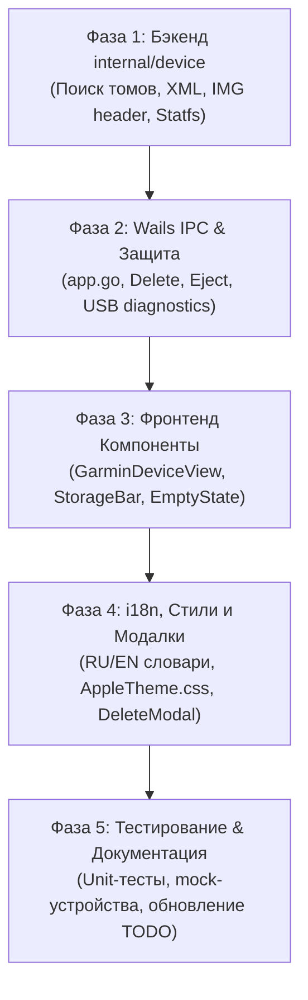

# Архитектурный и технический план: Задача #19 — Вкладка «Устройство Garmin» (Connected Watch & Custom Maps Explorer)

> **Статус**: План утвержден к реализации  
> **Версия спецификации**: 1.0.0  
> **Целевые платформы**: macOS (Apple Silicon / Intel), Windows 10/11 (x86-64), Linux  
> **Автор**: Senior Software Engineer / Lead Architect  

---

## 1. Введение и бизнес-цель

Задача #19 закрывает один из наиболее востребованных пользовательских сценариев в экосистеме **ZiMap Garmin Downloader**: работу с физически подключенными устройствами Garmin (часы линейки Fenix, Epix, Forerunner, Enduro, Instinct, велокомпьютеры Edge, туристические навигаторы GPSMAP, Montana, eTrex).

Пользователь подключает устройство кабелем USB к компьютеру, открывает вкладку **«Устройство Garmin»**, мгновенно видит:
1. Точную модель своего устройства (например, *«Garmin Fenix 7 Sapphire Solar»*), его серийный номер/Unit ID и версию прошивки.
2. Шкалу накопителя устройства (занято / свободно в гигабайтах) в стиле Apple HIG.
3. Каталог **исключительно пользовательских** карт (`gmapsupp.img` и именованные `.img`), с фильтрацией системных карт Garmin TopoActive, базовых карт рельефа и таймзон.
4. Внутреннее наименование карты (считываемое напрямую из бинарного заголовка `.img`).
5. Возможность безопасно удалить ненужную пользовательскую карту с подтверждением через модальное окно.
6. Кнопку безопасного извлечения накопителя (Safe Eject) без повреждения файловой системы FAT32/exFAT.

---

## 2. Аппаратные и протокольные нюансы Garmin (Hardware Architecture)

### 2.1. Режимы подключения: USB Mass Storage vs MTP

Garmin использует два принципиально разных режима работы по USB:

| Тип устройства | Примеры моделей | Протокол на macOS | Протокол на Windows | Особенности работы |
| :--- | :--- | :--- | :--- | :--- |
| **Велокомпьютеры & Навигаторы** | Edge 530/830/1030/1040, GPSMAP 66/67, eTrex 22x/32x, Montana 700 | **USB Mass Storage (UMS)** | **USB Mass Storage (UMS)** | Монтируется как стандартный диск в `/Volumes/GARMIN` или букву диска (напр. `E:\`). Полный прямой доступ к файловой системе. |
| **Классические часы** | Fenix 3/5/5 Plus, Forerunner 935, Vivoactive | **USB Mass Storage (UMS)** | **USB Mass Storage (UMS)** | Монтируется как стандартный том. Прямой доступ. |
| **Современные часы (MTP-only)** | Fenix 6/7/8, Epix Gen 2, Forerunner 955/965, Enduro 2/3, MARQ 2 | **MTP** (Media Transfer Protocol) | **MTP** / WPD (Windows Portable Devices) | На macOS ядро **не монтирует MTP как том** без сторонних утилит (OpenMTP, MacFusion, Android File Transfer). На Windows доступен через Shell Namespace/WPD. Некоторые часы имеют настройку *System → USB Mode → Mass Storage / Garmin*. |

### 2.2. Архитектурное решение для мультиплатформенности

Чтобы обеспечить максимальную надежность без утяжеления приложения нестабильными CGO/libusb зависимостями, архитектура разделяется на два уровня:

```
┌────────────────────────────────────────────────────────────────────────┐
│                        Device Scanner Pipeline                         │
├────────────────────────────────────────────────────────────────────────┤
│ 1. Volume Mount Scanner (Основной, 100% надёжный)                     │
│    - macOS: сканирование /Volumes/*                                    │
│    - Windows: перебор логических томов A:\ - Z:\                       │
│    - Linux: сканирование /media/$USER/* и /run/media/$USER/*           │
│    - Проверка наличия каталога GARMIN/ или файла GarminDevice.xml      │
├────────────────────────────────────────────────────────────────────────┤
│ 2. Hardware USB Fallback & Diagnostics (Диагностический уровень)        │
│    - Проверка наличия подключенного Garmin по USB Vendor ID (0x091E)   │
│    - macOS: system_profiler SPUSBDataType                              │
│    - Windows: WMI (Win32_PnPEntity WHERE DeviceID LIKE '%VID_091E%')   │
│    - Результат: если USB-устройство Garmin найдено, но том не смонти-  │
│      рован (MTP на macOS) -> UI показывает информативный гайд-баннер   │
│      по переключению USB-режима или монтированию.                      │
└────────────────────────────────────────────────────────────────────────┘
```

---

## 3. Анатомия файловой структуры Garmin и классификация карт

### 3.1. Структура каталогов на устройстве

Стандартный накопитель Garmin имеет следующую организацию:
```
<MountRoot>/
├── GARMIN/                          # Основной каталог прошивки и данных
│   ├── GarminDevice.xml             # XML-манифест устройства (ID, модель, пути)
│   ├── gmapbmap.img                 # [СИСТЕМНАЯ] Базовая карта мира
│   ├── gmaptz.img                   # [СИСТЕМНАЯ] Часовые пояса
│   ├── gmapdem.img                  # [СИСТЕМНАЯ] Цифровая модель рельефа (DEM)
│   ├── gmapprom.img                 # [СИСТЕМНАЯ] Предустановленная TopoActive
│   ├── d6185070a.img                # [СИСТЕМНАЯ] Региональный тайл TopoActive
│   ├── gmapsupp.img                 # [ПОЛЬЗОВАТЕЛЬСКАЯ] Дополнительная карта
│   ├── russia_center.img            # [ПОЛЬЗОВАТЕЛЬСКАЯ] Именованная карта (Fenix 5+/6/7/8)
│   ├── Map/                         # Дополнительный каталог карт на новых моделях
│   │   ├── alps_topo.img            # [ПОЛЬЗОВАТЕЛЬСКАЯ] Карта в подкаталоге Map
│   │   └── d4713020a.img            # [СИСТЕМНАЯ] Тайл TopoActive
│   └── Activity/ Courses/ GPX/ ...  # Прочие каталоги тренировок и треков
```

### 3.2. Матрица классификации карт (Factory vs Custom)

Критически важно защитить системные карты производителя от случайного или намеренного удаления пользователем. Удаление базовой карты или таймзон нарушает работу прошивки часов.

#### Системные заводские карты (Строгий Черный Список — ЗАПРЕЩЕНО удалять):
1. `gmapbmap.img`, `gmapbmap.sum` — Worldwide Basemap.
2. `gmaptz.img`, `gmaptz.sum` — Timezone Map.
3. `gmapdem*.img` — Digital Elevation Model (рельеф для альтиметра).
4. `gmapprom*.img` — Pre-installed primary maps (TopoActive / City Navigator).
5. `gmapgc*.img` — Geocaching database.
6. `gmap3d*.img` — 3D landmarks & terrain shading.
7. Регулярное выражение `^d[0-9]{7}[a-z0-9]?\.img$` (регистронезависимо) — официальные тайловые карты Garmin TopoActive (например, `d6185070a.img`, `d4713020a.img`).

#### Пользовательские карты (Белый Список — разрешены к отображению и управлению):
1. `gmapsupp.img`, `gmapsupp1.img`, `gmapsup2.img` — традиционный контейнер карт.
2. Любые файлы с расширением `.img`, чьи имена **не подпадают** под системный черный список (например, `cyprus.img`, `russia_central.img`, `finland_topo.img`).

---

## 4. Спецификация метаданных

### 4.1. Разбор `GarminDevice.xml`

Манифест `GARMIN/GarminDevice.xml` генерируется прошивкой при каждой перезагрузке устройства.

```xml
<?xml version="1.0" encoding="UTF-8"?>
<Device xmlns="http://www.garmin.com/xmlschemas/GarminDevice/v2">
  <Model>
    <PartNumber>006-B3906-00</PartNumber>
    <SoftwareVersion>1577</SoftwareVersion>
    <Description>Fenix 7 Sapphire Solar</Description>
  </Model>
  <Id>3425167890</Id>
  <DisplayName>Fenix 7</DisplayName>
  <MassStorageMode>
    <DataType>
      <Name>SupplementalMaps</Name>
      <File>
        <Specification>
          <Identifier>IMG</Identifier>
        </Specification>
        <Location>
          <Path>GARMIN</Path>
          <FileExtension>IMG</FileExtension>
        </Location>
      </File>
    </DataType>
  </MassStorageMode>
</Device>
```

#### Go-структура для десериализации (`encoding/xml`):
```go
type GarminDeviceXML struct {
    XMLName xml.Name `xml:"Device"`
    Model   struct {
        PartNumber      string `xml:"PartNumber"`
        SoftwareVersion string `xml:"SoftwareVersion"`
        Description     string `xml:"Description"`
    } `xml:"Model"`
    UnitID      string `xml:"Id"`
    DisplayName string `xml:"DisplayName"`
}
```

### 4.2. Чтение внутреннего названия карты из заголовка `.img`

Каждый Garmin `.img` файл (формат GMP / Disk image) содержит заголовок. На смещении `0x49` (73 байта от начала файла) находится ASCII-строка длиной до 30 байт, заданная mkgmap при компиляции (параметр `--description="OSM Central District"`).

Чтение первых 200 байт файла позволяет отображать в UI понятное человеческое имя:
- Имя файла: `gmapsupp.img`
- Внутреннее имя: *"OSM Russia Central (ZiMap 2026)"*

---

## 5. Архитектура Go-бэкенда (`internal/device`)

Пакет `internal/device` изолирует всю работу с оборудованием и файловыми системами:

```
internal/device/
├── device.go             # Модели данных: GarminDevice, DeviceMap, StorageInfo
├── detector.go           # Общий интерфейс сканирования и кэширования
├── detector_darwin.go    # Реализация для macOS (/Volumes + diskutil eject)
├── detector_windows.go   # Реализация для Windows (буквы дисков + Shell COM eject)
├── detector_linux.go     # Реализация для Linux (/media, /run/media + umount)
├── filter.go             # Черный/белый список карт и валидация безопасности
├── img_parser.go         # Чтение заголовка .img (internal name, creation time)
├── storage.go            # Кроссплатформенный замер свободного/общего места (statfs)
├── usb_diagnostics.go    # Проверка Garmin USB VID 0x091E (fallback при отсутствии тома)
└── device_test.go        # Модульные тесты для парсера XML, заголовков IMG и фильтров
```

### 5.1. Контракт моделей данных (`device.go`)

```go
package device

import "time"

type StorageInfo struct {
    TotalBytes     uint64  `json:"totalBytes"`
    FreeBytes      uint64  `json:"freeBytes"`
    UsedBytes      uint64  `json:"usedBytes"`
    UsedPercentage float64 `json:"usedPercentage"`
    FormattedTotal string  `json:"formattedTotal"`
    FormattedFree  string  `json:"formattedFree"`
    FormattedUsed  string  `json:"formattedUsed"`
}

type DeviceMap struct {
    FileName     string    `json:"fileName"`
    FilePath     string    `json:"filePath"`
    InternalName string    `json:"internalName"` // Из заголовка IMG
    SizeBytes    int64     `json:"sizeBytes"`
    SizeFormatted string   `json:"sizeFormatted"`
    ModTime      time.Time `json:"modTime"`
    IsCustom     bool      `json:"isCustom"`     // true, если разрешена к удалению
    RelativeDir  string    `json:"relativeDir"`  // "GARMIN" или "GARMIN/Map"
}

type GarminDevice struct {
    MountPath       string      `json:"mountPath"`
    VolumeName      string      `json:"volumeName"`
    ModelName       string      `json:"modelName"`       // Из GarminDevice.xml
    DisplayName     string      `json:"displayName"`
    UnitID          string      `json:"unitId"`
    SoftwareVersion string      `json:"softwareVersion"`
    Storage         StorageInfo `json:"storage"`
    CustomMaps      []DeviceMap `json:"customMaps"`
    TotalMapsCount  int         `json:"totalMapsCount"`  // Включая системные
    ConnectedAt     time.Time   `json:"connectedAt"`
}

type USBStatus struct {
    GarminUSBAttached bool   `json:"garminUsbAttached"` // Найден ли VID 0x091E
    DeviceDescription string `json:"deviceDescription"`
    NeedsMTPNotice    bool   `json:"needsMtpNotice"`    // True если USB есть, а тома нет
}
```

### 5.2. Правила валидации безопасности удаления (`filter.go`)

```go
func IsSystemMap(fileName string) bool {
    lower := strings.ToLower(filepath.Base(fileName))
    if !strings.HasSuffix(lower, ".img") {
        return true // Не .img файлы трогать нельзя
    }
    
    // Системные префиксы
    systemPrefixes := []string{
        "gmapbmap", "gmaptz", "gmapdem", "gmapprom", 
        "gmapgc", "gmap3d",
    }
    for _, prefix := range systemPrefixes {
        if strings.HasPrefix(lower, prefix) {
            return true
        }
    }
    
    // Паттерн тайлов Garmin TopoActive: d + 7 цифр (+ опциональная буква/цифра) + .img
    // Например: d6185070a.img, d4713020a.img
    matched, _ := regexp.MatchString(`^d\d{7}[a-z0-9]?\.img$`, lower)
    return matched
}
```

**Guardrail при удалении**:
Метод `DeleteDeviceMap(mountPath, relativePath string) error`:
1. Проверяет, что `mountPath` является валидным смонтированным устройством Garmin.
2. Проверяет, что `filepath.Clean(relativePath)` не содержит `..` и строго находится внутри `<mountPath>/GARMIN/` или `<mountPath>/GARMIN/Map/`.
3. Вызывает `IsSystemMap(relativePath)` — при `true` немедленно возвращает `ErrSystemMapProtected` (HTTP 403 / ошибка безопасности).
4. Только после прохождения всех проверок выполняет `os.Remove`.

---

## 6. Wails IPC API (`app.go`)

В `app.go` реализуются следующие методы, экспортируемые во фронтенд:

| Метод Go | Возвращаемое значение | Назначение |
| :--- | :--- | :--- |
| `GetConnectedGarminDevices()` | `([]device.GarminDevice, error)` | Сканирует тома, возвращает список подключенных устройств Garmin и их пользовательские карты. |
| `GetGarminUSBStatus()` | `(device.USBStatus, error)` | Диагностика: подключено ли устройство по USB (для вывода подсказок MTP). |
| `DeleteDeviceMap(mountPath, filePath string)` | `error` | Безопасное удаление пользовательской карты с валидацией. |
| `EjectGarminDevice(mountPath string)` | `error` | Нативное размонтирование и извлечение накопителя. |
| `RevealDevicePath(filePath string)` | `error` | Открытие файла или папки на часах в Finder / Explorer. |

---

## 7. Фронтенд-архитектура React & Apple HIG UI

### 7.1. Размещение в навигации

В боковом меню (`Sidebar`) добавляется новый пункт с иконкой смарт-часов `Watch` из библиотеки `lucide-react`:
```jsx
// В секции MAPS & CATALOG или отдельной секции DEVICES:
{ 
  id: 'device', 
  icon: Watch, 
  label: t('nav.device'),
  badge: connectedDevice ? '●' : null,
  badgeColor: 'var(--system-green)'
}
```

### 7.2. Структура представлений `GarminDeviceView`

```
┌────────────────────────────────────────────────────────────────────────┐
│ [Watch] Garmin Fenix 7 Sapphire Solar      [Eject] [Reveal] [Refresh]  │
│ Unit ID: 3425167890 • Прошивка: v15.77 • Точка: /Volumes/GARMIN        │
├────────────────────────────────────────────────────────────────────────┤
│ ПАМЯТЬ УСТРОЙСТВА                                                      │
│ [████████████████████████████░░░░░░░░░░░░░░░░░░░░░] 14.2 ГБ / 32.0 ГБ   │
│ Занято: 14.2 ГБ • Свободно: 17.8 ГБ (55%)                              │
├────────────────────────────────────────────────────────────────────────┤
│ ПОЛЬЗОВАТЕЛЬСКИЕ КАРТЫ НА ЧАСАХ (2)                                    │
│ ┌────────────────────────────────────────────────────────────────────┐ │
│ │ [MapPin] OSM Russia Central                 .IMG   [2.1 ГБ]        │ │
│ │ Файл: russia_central.img • Папка: GARMIN/Map                       │ │
│ │ Изменено: 12 окт 2026, 18:40                                       │ │
│ │                             [В Finder / Проводнике]  [Удалить]     │ │
│ └────────────────────────────────────────────────────────────────────┘ │
│ ┌────────────────────────────────────────────────────────────────────┐ │
│ │ [MapPin] Cyprus OSM High Detail            .IMG   [340 МБ]         │ │
│ │ Файл: gmapsupp.img • Папка: GARMIN                                 │ │
│ │ Изменено: 5 сен 2026, 12:15                                        │ │
│ │                             [В Finder / Проводнике]  [Удалить]     │ │
│ └────────────────────────────────────────────────────────────────────┘ │
└────────────────────────────────────────────────────────────────────────┘
```

### 7.3. Состояния пустого экрана (Empty State & MTP Diagnostics)

1. **Устройство не обнаружено**:
   - Красивая иконка часов с мягкой анимацией дыхания.
   - Заголовок: *«Подключите устройство Garmin через USB»*.
   - Подзаголовок: *«Поддерживаются часы Fenix, Epix, Forerunner, велокомпьютеры Edge и навигаторы GPSMAP»*.
2. **Обнаружено MTP-устройство (актуально для macOS)**:
   - Если `GetGarminUSBStatus().NeedsMTPNotice === true`:
   - Отображается информационная карточка Apple HIG цвета `--system-orange` с иконкой `AlertCircle`:
     - *«Обнаружены часы Garmin (режим MTP). На macOS для прямого доступа к файловой системе переключите часы в режим накопителя (Настройки часов → Система → Режим USB → Garmin / Накопитель) либо используйте OpenMTP»*.

### 7.4. Модальное окно удаления (`DeleteDeviceMapModal`)

- Аутентичный Apple HIG Sheet (`.modal-sheet` с backdrop blur).
- Четкое предупреждение: *«Карта «{name}» ({fileName}) будет безвозвратно удалена из памяти устройства Garmin. Это действие нельзя отменить.»*
- Деструктивная красная кнопка подтверждения с индикатором загрузки (`Удалить карту`).

---

## 8. Пошаговый план реализации (5 Фаз)



### Фаза 1: Ядро бэкенда `internal/device`
- [ ] Создать директорию `internal/device/`.
- [ ] Реализовать `internal/device/device.go` (структуры данных).
- [ ] Реализовать `internal/device/storage.go` (кроссплатформенный замер диска: `syscall.Statfs` для Darwin/Linux, `GetDiskFreeSpaceExW` для Windows).
- [ ] Реализовать `internal/device/img_parser.go` (парсинг смещения 0x49 для извлечения внутреннего имени карты).
- [ ] Реализовать `internal/device/filter.go` (фильтрация системных карт TopoActive и basemap).
- [ ] Реализовать `internal/device/detector.go` с платформенными сканерами (`detector_darwin.go`, `detector_windows.go`, `detector_linux.go`).
- [ ] Написать unit-тесты в `internal/device/device_test.go` с mock-файлами `GarminDevice.xml` и mock `.img` заголовками.

### Фаза 2: Интеграция в Wails (`app.go`)
- [ ] Экспортировать `GetConnectedGarminDevices()`, `DeleteDeviceMap()`, `EjectGarminDevice()`, `GetGarminUSBStatus()`.
- [ ] Реализовать безопасное извлечение накопителя (`diskutil eject` на macOS, PowerShell Eject на Windows).
- [ ] Обеспечить защиту от удаления системных файлов на уровне `app.go`.
- [ ] Обновить Wails-биндинги (`wails generate module` / типы в `frontend/wailsjs`).

### Фаза 3: Фронтенд — Вкладка «Устройство Garmin»
- [ ] Добавить вкладку `device` в `Sidebar` в `frontend/src/App.jsx`.
- [ ] Создать компонент `GarminDeviceView`:
  - Карточка устройства с моделью, серийником и прошивкой.
  - Полоса хранилища `DeviceStorageBar` (Apple HIG градиентная полоса).
  - Карточки пользовательских карт с размером, датой и кнопками действий.
  - Состояние загрузки (Skeleton loader / spinner).
  - Пустое состояние (Empty state) и MTP-баннер.

### Фаза 4: Локализация, модальные окна и стили
- [ ] Добавить полные словари локализации (RU/EN) в `frontend/src/i18n.js` для всех элементов вкладки устройства.
- [ ] Добавить модальное окно подтверждения удаления карты `DeleteDeviceMapModal`.
- [ ] Оформить стили в `frontend/src/AppleTheme.css` (плашки статуса, шкалы накопителя, адаптивная верстка под узкие окна).

### Фаза 5: Тестирование, верификация и обновление документации
- [ ] Протестировать с виртуальным томом (создать образ диска `GARMIN` с тестовыми файлами `.img` и `GarminDevice.xml`).
- [ ] Протестировать обработку ошибок (извлечение диска во время работы, недоступность прав).
- [ ] Запустить полный цикл тестов: `go test -count=1 ./...` и сборку `npm run build`.
- [ ] Обновить `TODO.md` и `AGENTS.md` со ссылкой на данный план.

---

## 9. План тестирования и верификации

### 9.1. Mock-тестирование без физического устройства
Для полноценного тестирования в коде предусмотрен mock-режим / создание тестового смонтированного каталога:
```bash
# Тестовый сценарий на macOS:
hdiutil create -size 500m -fs MS-DOS -volname GARMIN /tmp/garmin_test.dmg
hdiutil attach /tmp/garmin_test.dmg
mkdir -p /Volumes/GARMIN/GARMIN/Map
# Скопировать фиктивный GarminDevice.xml и тестовый .img
```
Тест валидирует:
1. Корректность распознавания модели и серийного номера.
2. Корректность замера свободного места (500 МБ).
3. Отображение только тестовой карты и скрытие системных файлов.
4. Успешное удаление и обновление списка.
5. Корректную отработку `diskutil eject`.

---

## 10. Связь с Задачей #20 (Map Freshness & Sync)

Реализация Задачи #19 создает **фундаментальную платформенную базу** для последующей Задачи #20:
- Задача #19 дает структуру `GarminDevice`, список карт `DeviceMap` и доступ к точке монтирования.
- В Задаче #20 потребуется лишь добавить функцию сверки `ModTime` с локальной папкой `output/` и функцию потокового копирования `SyncMapToDevice`.
- Таким образом, архитектура Задачи #19 изначально проектируется расширяемой и готовой к синхронизации.
